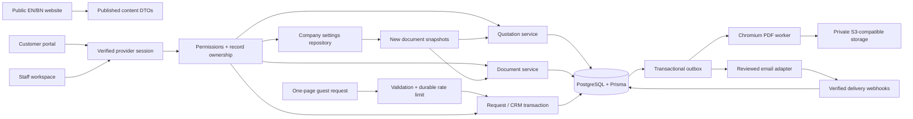

# Phase A architecture and execution boundaries

Date: 8 November 2026. This is a proposal and local implementation foundation, not a deployed business backend. See the [Phase A report](./phase-a-report.md), [schema](../prisma/proposals/phase-a.prisma), [SQL](../prisma/proposals/phase-a.sql), and [complete ER diagram](./phase-a-schema-erd.md).

## Module boundaries

Current implementations are the local UI, calculation/template/policy helpers, and provider-neutral TypeScript contracts. Database repositories, production session verification, workers, provider adapters, and actual dispatch are NOT implemented. No UI state is represented as a persisted operational record.

The public website continues to import its public-only settings and static catalog. Private prices must live behind server-only repositories. New public DTOs must explicitly select published fields; never serialize Prisma records or private price relations into public components. Customer documents require per-record authorization on every viewer/download, including route handlers and signed-URL issuance. Private reads must not use shared `use cache` scopes.

## Data design

The proposal is an additive logical model with 58 new tables; the active health-check schema and migration remain unchanged. JSON is used for immutable historical snapshots, multilingual flexible content, and configuration. Queryable financial values, statuses, keys, recipients, role scopes, assignments, and ownership remain typed relational fields.

| Domain | Core records and invariants |
| --- | --- |
| Identity | Provider-linked User and Session, Role, Permission, RolePermission, RoleAssignment, VerifiedContact, ContactChallenge, AuditLog. No custom password hash or recovery implementation. |
| CRM | Customer, Organization, BusinessContact, CustomerAddress, GuestIdentity. CRM email/phone fields are not proof of account identity; organization membership never grants portal document access automatically. |
| Catalog | Category tree, localized categories/products/services, private product price, inventory, collections, product/service relationships, ordered media. Specifications use bounded localized JSON to avoid a table for every variable attribute. |
| Operations | CustomerRequest and RequestItem snapshots, typed history, private notes, RequestClaim, Visit, StaffAssignment. A Visit represents consultation/booking/site/office scheduling with explicit confirmation. Submitting a request never confirms an appointment. |
| Quotations | Quotation with optional request/customer/organization; versioned snapshots, lines, recipients, approval records, events, current-issued pointer. Header amounts are Decimal(18,2); quantity uses Decimal(16,4). |
| Documents | BusinessDocument, DocumentVersion, DocumentTemplate, immutable TemplateVersion, GeneratedDocument. Separate versions retain sender/company/recipient snapshots and renderer/content hashes. |
| Communication | Versioned EmailTemplate, EmailMessage, typed recipients, authorized generated attachments, DeliveryAttempt, verified unique ProviderWebhookEvent, Notification, durable OutboxJob. |
| Content/media/settings | CompanySettings, MediaAsset, ProductMedia, localized ContentEntry. Projects/reviews/careers can share a publication shell. Applications, variants, service/project media joins and advanced CMS editor structures remain later detailed work. |

No production seed data is supplied. Role/permission bootstrap and real public-content migration must be individually reviewed. Public concept slugs must be preserved through legacy IDs when records move to PostgreSQL. Keep unverified marketing content publication-gated.

The proposed SQL adds financial checks, positive quantities, target exclusivity, contact/request ownership constraints, private-asset URL isolation, a unique successful claim, row locking for issued quotation children, immutable issued content and append-only audit/approval/template/file metadata. It revokes generic Supabase Data API access and enables RLS. These SQL protections have NOT been executed or integration-tested. RLS is not a substitute for application authorization: review the actual runtime role, owner/bypass behavior, privileges and policies before any execution.

## Guest requests and later account claiming

1. Public request creation accepts no mandatory account. Validate a bounded allowlisted DTO, published catalog IDs, quantities, dates, contact normalization, honeypot, origin/CSRF as applicable, and a durable per-IP/contact rate budget. Require an unpredictable idempotency key. Do not rely on process memory for rate limiting on Vercel.
2. In one transaction create a guest/customer request, item/contact snapshots, `PENDING_REVIEW` status event, and sanitized audit/outbox records. Return only an opaque reference and safe status AFTER commit. A signed-in customer association must come from the verified server session, never a submitted customer ID.
3. A later account verifies its contact through the authentication provider or a short-lived one-use challenge. Store only a token hash. Normalize email conservatively; do not strip dots/plus suffixes. Normalize phones to reviewed E.164 rules. Phone OTP remains disabled until an actual SMS provider is installed.
4. Contact verification finds candidate requests; it does not grant access. Ask for the private request reference plus an independent claim challenge delivered to the recorded historical contact. Generic responses must not disclose whether a contact/reference exists. Use expiry, attempt limits, contact/IP/account throttles, and recent authentication.
5. Lock the request and contact rows in a transaction. Revalidate current contact verification, token hash/purpose/expiry, ownership, and conflicts. Attach only an unowned eligible request, consume the challenge, write a verified claim and audit event. A partial unique index prevents two verified claimants. Concurrent claims must be exercised in staging before launch.
6. Shared/reassigned numbers, inconsistent names, incomplete historic contacts, contact changes, or already-owned records enter manual review requiring stronger evidence. Never bulk-claim all matching records. Do not reveal existing owners. Revocation and subsequent disputes need auditable staff resolution.
7. Portal request ownership and official-document access are separate. A claim does not grant every quotation for the same company or contact. A `PortalGrant` deliberately identifies the user and the officially issued quotation/document version. Revisions need a separately reviewed grant policy.

The pure claim/visibility tests demonstrate policy predicates only. They are not evidence of live authentication, OTP, persistence, or row-level isolation.

## Authentication and configurable permissions

There is currently no authentication provider. Keep the unified login disabled until it can perform real verification. Recommended next implementation: **Better Auth with its maintained Prisma/PostgreSQL adapter**, subject to a pinned-version review against Next.js 16.4.4 and Node 24. The adapter must supply credential handling, sessions, verification and recovery; this proposal does not implement those itself. Final adapter model fields/migrations must be reconciled with the logical User/Session records before approval. External provider account credentials/tokens belong in the provider's protected adapter records, never CRM/public records.

Use a server-only session adapter plus `requirePermission(scope)` and `requireOwnership(resource)` in every repository method. Read current role assignments from the database, check disabled users and session revocation, use opaque secure HttpOnly cookies and provider CSRF/origin protections, and audit privileged mutations. Treat the routing proxy as navigation assistance only. Customers can never acquire staff scopes through signup or profile fields. Role-based navigation is a Phase B view of the same server policy; the local reviewer has no actual role or privileges.

Provision the first Super Admin through a one-time, operator-run provider/admin workflow with an allowlisted identity, recent verification, MFA where supported, and an audit record. Never use a default password, public role picker, or automatic promotion based only on an email domain. ADMIN/STAFF require explicitly assigned scopes; SUPER_ADMIN manages scope definitions and assignments. Do not grant all privileged actions implicitly to every ADMIN.

Phase A production admin pages redirect to the shared login; business APIs return 401 with private/no-store headers. The local preview checks `NODE_ENV === development` after a request boundary and is unavailable in a production build. No host header, query parameter, preview cookie, or email match can enable admin access.

## Quotation creation, approval, issuance and revision

**Manual creation:** create a quotation without a request; select/create a CRM client or use an external recipient snapshot; add catalog/service/custom lines; enter authorized private prices; set currency/date/validity/site/terms; validate and save. No portal grant or customer account is inferred from recipient contact information. The local editor implements this preparation workflow with tab-local saves and export. CRM selection/creation remains unconnected.

**Request conversion:** authorized staff select an existing request, copy its item/contact snapshots into a new draft, and review descriptions, quantities and private prices. This workflow is planned; there is no persisted request to convert in Phase A.

**Financial policy v1:** BDT only in the UI; accept decimal strings; quantity up to four decimal places; unit prices/currency amounts to two; use BigInt internally with half-up rounding per line. Sum rounded lines, subtract a fixed document discount, compute tax on discounted subtotal, then add untaxed charges. The UI identifies this policy. Rate must be 0–100%, quantity positive, discount cannot exceed subtotal, total up to BDT 999,999,999,999.99, maximum 200 items. No floating-point arithmetic is used for money. Multiple currencies, per-line discount/tax rules and tax-on-charge policies require versioned implementations and owner/accountant policy confirmation.

**Approval:** Draft → Pending Approval → Approved. Approval is tied to a canonical content hash covering client, company, terms, recipients, lines, financial policy and calculated totals. Editing invalidates approval and increments optimistic lock version. Server-side actions must verify the current revision/hash and current approver scope, not a browser-calculated total.

**Issuance:** transactionally lock the quotation aggregate; verify approval/hash and recompute totals from stored lines; allocate a sequence number through the unique `(scope, period)` counter; freeze snapshots; append the status/audit record; update the current-issued pointer; queue an idempotent render job. No email job is enqueued just because a PDF was generated. Render/storage failures remain retriable and must not label a missing PDF as downloadable. Validate current pointer belongs to this aggregate and identifies the latest actually issued version.

**Revision:** create a new draft version with increasing revision, deliberately duplicate data, and reapprove/reissue. Never edit the previous issued lines, company/contact information, financial values or file. Until reissue, the previous issued version remains current. Issued → Sent → Viewed → Accepted/Rejected/Expired events require evidence. Viewed must mean an authorized viewer actually loaded the document; delivery is not viewing. Email failure must not undo issuance. Acceptance/rejection must be authenticated or use a narrowly scoped, reviewed token workflow.

Pure transition tests exist, but production transactions, current-version enforcement, sequence concurrency, approvals and revisions remain Phase B/C integration work. Do not use the local UI as a financial system.

## HTML/PDF and letter rendering

The [shared HTML master](../lib/business/documents.ts) renders quotation, A4 letterhead and email drafts. It escapes all user text, uses the real logo and current company snapshot, handles empty optional sections, shapes Bengali using existing licensed fonts, repeats table headings and keeps totals/rows together. Page numbers use Chromium paged-media margin boxes. No signature, seal, legal registration, bank account or official approval is invented. Request PDFs remain distinctly unpriced customer-prepared requests; these quotation drafts are also explicitly unapproved.

Phase A renders actual PDF bytes with the installed local Edge/Chromium print engine and embeds font/logo bytes in review fixture HTML. The UI supports browser Print / Save PDF. Browser export is not a production official-download adapter. A4 portrait is the implemented UI mode; the renderer contract supports a future explicit landscape choice, not yet exposed in the draft UI.

Recommended production adapter: pinned headless Chromium via a maintained browser automation library, with a reviewed Vercel-compatible binary or authenticated remote rendering worker; the same worker can run in a future VPS image. Benchmark cold starts, memory, package size and timeouts before choosing packaging. Server rendering accepts only internally generated HTML with escaped text, allowlisted local/embedded assets, blocked external navigation/network, bounded content and timeouts. Never give untrusted raw HTML or arbitrary asset URLs access to a server renderer. Store the finished PDF, its SHA-256, renderer version and canonical snapshot hash in private R2 through an outbox job.

The report links actual PDF captures, including English, Bengali, long descriptions, large totals, empty optional fields and multi-page output. Very long single rows larger than an entire printable page, multi-page terms and varying future fonts require additional production layout tests; draft previews do not certify every possible document.

## Document Studio and Email Center

Document Studio implements recipient/sender/subject/body editing, document-type selection, local saves/export, safe plain-text template variables, missing-variable validation and live letterhead/print. Type selection classifies the local draft; it does not generate factual claims or an automatically authored letter. Saved templates, template version history, approval, attachments, official references and private file storage remain unconnected.

Email Center implements To/CC/BCC input, subject/message editing, a branded safe plain-text-to-HTML preview and local saves/export. It does not send, attach files, track delivery, or offer a fabricated working rich-HTML editor. Use a sanitized rich-text editor later; plain text is escaped today.

Choose a legitimate transactional provider only after verifying the sending domain. A provider adapter receives a previously reviewed immutable message revision and idempotency key. Preview and explicit authorized approval are separate from generation. After editing, invalidate review. Store one outbox send job and provider ID; API success means ACCEPTED only. Signed, deduplicated provider webhooks determine delivered/failed states; webhooks must be verified against raw request bytes before processing. Retry with bounded exponential backoff, stable idempotency, and visibility into errors. BCC stays hidden from other recipients and customer communication views. Never retry a rejected/uncertain send blindly without checking provider idempotency evidence.

Configure sender and reply-to in Company Settings, independent of public contact email. Add provider-supplied SPF records without creating a second SPF record, publish provider DKIM selectors and verify signing, then stage DMARC monitoring and tighten alignment/enforcement after inspecting reports. Do not claim the domain is verified before actual DNS/provider evidence.

## Storage, maps, analytics and portability

Use separate public media and private document/quarantine buckets with server-generated immutable object keys. Validate MIME signature, bytes, size and actual image decoding; strip metadata; do not trust file extensions or declared browser MIME. Authorize each presigned upload/finalization/download; limit CORS to intended origins. Finish quarantined uploads by copying to new immutable keys, not by publishing an object still writable with an old upload URL. Store metadata in PostgreSQL and retain referenced issued-document objects. Reconcile orphan/quarantine objects only after retention and a fresh reference check. No R2 request is made by Phase A.

Dashboard measures must be bounded database aggregates with Asia/Dhaka date boundaries and drill-down permissions. The current unavailable markers are deliberately not zero-valued sales claims. Existing published concept/service counts are labeled as content counts. CRM/operations are honest disconnected states. Maps remain list-first until authorized real coordinates and a licensed/cost-reviewed map/geocoding provider are configured; no private map data reaches public pages.

Keep standard Next.js output, Prisma migrations, PostgreSQL, S3-compatible storage, renderer/email adapters and environment configuration. Current native builds do not require DB/provider credentials. Future Docker/VPS builds should run web and durable workers separately, use managed backups and object recovery, and restore to a new isolated database before cutover. Do not apply migrations on each web-server startup.

## Proposed environment names

These are planned interfaces, not newly required secrets for Phase A. No environment file was changed.

| Names | Intended use |
| --- | --- |
| `DATABASE_URL`, `DIRECT_URL` | Pooled runtime and separate migration-capable Supabase connections. Select actual endpoints/role privileges/TLS after target review. |
| `BETTER_AUTH_SECRET`, `BETTER_AUTH_URL`, `AUTH_TRUSTED_ORIGINS` | Proposed auth configuration; pin the adapter and confirm its actual variable/API wiring in Phase B. |
| `R2_ACCOUNT_ID`, `R2_ACCESS_KEY_ID`, `R2_SECRET_ACCESS_KEY`, `R2_PUBLIC_BUCKET`, `R2_PRIVATE_BUCKET`, `R2_PUBLIC_BASE_URL` | Server-only storage adapter plus approved public media base URL. |
| `EMAIL_PROVIDER`, `EMAIL_API_KEY`, `EMAIL_WEBHOOK_SECRET` | Server-only transactional adapter; sender/reply-to come from validated Company Settings. |
| `PDF_RENDERER_URL`, `PDF_RENDERER_TOKEN` | Only if a remote authenticated Chromium worker is selected. |
| `RATE_LIMIT_BACKEND_URL`, `RATE_LIMIT_BACKEND_TOKEN` | Only if an external durable limiter is chosen; PostgreSQL is an alternative. |
| `SMS_PROVIDER`, `SMS_API_KEY` | Optional future phone verification; unsupported until integrated. |
| `MAP_PROVIDER`, `MAP_API_KEY` | Optional later maps; distinguish restricted browser token from private server geocoding credentials. |
| `AIA_REVIEW_BROWSER` | Optional implemented QA executable path; default is installed Microsoft Edge. |

No Supabase service key is needed merely to use PostgreSQL through Prisma. Do not put privileged keys into `NEXT_PUBLIC_*` variables. Never populate an unimplemented provider configuration solely to make this review look connected.
