# Phase A proposed entity relationships

Review only; the active database still has only its health probe model. Generated from the [schema proposal](../prisma/proposals/phase-a.prisma) by the offline review helper. This diagram shows relational links; JSON snapshots deliberately preserve issued history independently of mutable CRM/company data.

```mermaid
erDiagram
  User {
    String id
    String providerId
  }
  Session {
    String id
    String providerSessionId
  }
  User ||--o{ Session : "user"
  Role {
    String id
    String name
  }
  Permission {
    String scope
  }
  Role ||--o{ RolePermission : "role"
  Permission ||--o{ RolePermission : "permission"
  User ||--o{ RoleAssignment : "user"
  Role ||--o{ RoleAssignment : "role"
  VerifiedContact {
    String id
  }
  User ||--o{ VerifiedContact : "user"
  ContactChallenge {
    String id
    String tokenHash
  }
  User ||--o{ ContactChallenge : "user"
  AuditLog {
    String id
  }
  User |o--o{ AuditLog : "actor"
  Customer {
    String id
    String userId
  }
  User |o--o{ Customer : "user"
  Organization |o--o{ Customer : "organization"
  Organization {
    String id
  }
  BusinessContact {
    String id
  }
  Organization ||--o{ BusinessContact : "organization"
  CustomerAddress {
    String id
  }
  Customer ||--o{ CustomerAddress : "customer"
  GuestIdentity {
    String id
  }
  Category {
    String id
    String slug
  }
  Category |o--o{ Category : "parent"
  Category ||--o{ CategoryTranslation : "category"
  Product {
    String id
    String slug
    String legacyId
  }
  Category ||--o{ Product : "category"
  Product ||--o{ ProductTranslation : "product"
  PrivateProductPrice {
    String productId
  }
  Product ||--o{ PrivateProductPrice : "product"
  Inventory {
    String productId
  }
  Product ||--o{ Inventory : "product"
  Collection {
    String id
    String slug
  }
  Product ||--o{ ProductCollection : "product"
  Collection ||--o{ ProductCollection : "collection"
  Service {
    String id
    String slug
  }
  Category ||--o{ Service : "category"
  Service ||--o{ ServiceTranslation : "service"
  Product ||--o{ ProductService : "product"
  Service ||--o{ ProductService : "service"
  CustomerRequest {
    String id
    String reference
    String idempotencyKey
  }
  Customer |o--o{ CustomerRequest : "customer"
  GuestIdentity |o--o{ CustomerRequest : "guest"
  RequestItem {
    String id
  }
  CustomerRequest ||--o{ RequestItem : "request"
  Product |o--o{ RequestItem : "product"
  Service |o--o{ RequestItem : "service"
  RequestClaim {
    String id
    String proofHash
  }
  CustomerRequest ||--o{ RequestClaim : "request"
  User ||--o{ RequestClaim : "user"
  VerifiedContact ||--o{ RequestClaim : "verifiedContact"
  RequestStatusEvent {
    String id
    String auditId
  }
  CustomerRequest ||--o{ RequestStatusEvent : "request"
  RequestNote {
    String id
  }
  CustomerRequest ||--o{ RequestNote : "request"
  User ||--o{ RequestNote : "author"
  Visit {
    String id
  }
  CustomerRequest ||--o{ Visit : "request"
  Visit ||--o{ StaffAssignment : "visit"
  User ||--o{ StaffAssignment : "user"
  Quotation {
    String id
    String number
    String currentIssuedVersionId
  }
  CustomerRequest |o--o{ Quotation : "request"
  Customer |o--o{ Quotation : "customer"
  Organization |o--o{ Quotation : "organization"
  QuotationVersion |o--o{ Quotation : "currentIssuedVersion"
  QuotationVersion {
    String id
  }
  Quotation ||--o{ QuotationVersion : "quotation"
  User ||--o{ QuotationVersion : "author"
  QuotationItem {
    String id
  }
  QuotationVersion ||--o{ QuotationItem : "version"
  Product |o--o{ QuotationItem : "product"
  Service |o--o{ QuotationItem : "service"
  QuotationRecipient {
    String id
  }
  QuotationVersion ||--o{ QuotationRecipient : "version"
  QuotationStatusEvent {
    String id
    String auditId
  }
  QuotationVersion ||--o{ QuotationStatusEvent : "version"
  PortalGrant {
    String id
    String auditId
  }
  User ||--o{ PortalGrant : "user"
  QuotationVersion |o--o{ PortalGrant : "quotationVersion"
  DocumentVersion |o--o{ PortalGrant : "documentVersion"
  DocumentTemplate {
    String id
  }
  TemplateVersion {
    String id
  }
  DocumentTemplate ||--o{ TemplateVersion : "template"
  BusinessDocument {
    String id
    String reference
    String currentIssuedVersionId
  }
  Customer |o--o{ BusinessDocument : "customer"
  Organization |o--o{ BusinessDocument : "organization"
  DocumentVersion |o--o{ BusinessDocument : "currentIssuedVersion"
  DocumentVersion {
    String id
  }
  BusinessDocument ||--o{ DocumentVersion : "document"
  User ||--o{ DocumentVersion : "author"
  TemplateVersion |o--o{ DocumentVersion : "templateVersion"
  ApprovalRecord {
    String id
  }
  QuotationVersion |o--o{ ApprovalRecord : "quotationVersion"
  DocumentVersion |o--o{ ApprovalRecord : "documentVersion"
  User ||--o{ ApprovalRecord : "approver"
  GeneratedDocument {
    String id
    String assetId
  }
  QuotationVersion |o--o{ GeneratedDocument : "quotationVersion"
  DocumentVersion |o--o{ GeneratedDocument : "documentVersion"
  MediaAsset ||--o{ GeneratedDocument : "asset"
  EmailTemplate {
    String id
  }
  EmailMessage {
    String id
    String idempotencyKey
    String providerMessageId
  }
  User ||--o{ EmailMessage : "author"
  EmailRecipient {
    String id
  }
  EmailMessage ||--o{ EmailRecipient : "email"
  EmailMessage ||--o{ EmailAttachment : "email"
  GeneratedDocument ||--o{ EmailAttachment : "document"
  DeliveryAttempt {
    String id
  }
  EmailMessage ||--o{ DeliveryAttempt : "email"
  ProviderWebhookEvent {
    String id
  }
  Notification {
    String id
  }
  User ||--o{ Notification : "user"
  OutboxJob {
    String id
    String idempotencyKey
  }
  CompanySettings {
    String id
  }
  MediaAsset {
    String id
    String objectKey
  }
  Product ||--o{ ProductMedia : "product"
  MediaAsset ||--o{ ProductMedia : "asset"
  ContentEntry {
    String id
  }
  ContentEntry ||--o{ ContentTranslation : "entry"
```

