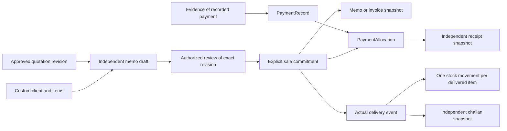

# Phase A.1 sales and inventory migration review

Review prepared 9 November 2026. **No SQL has been applied, no database has been seeded, and no live database contents were inspected or certified.** The active Prisma schema and executable migration history are unchanged.

## Review artifacts and impact

Read the original [Phase A review packet](phase-a-migration-review.md) first. The [combined Prisma proposal](../prisma/proposals/phase-a1.prisma) includes that foundation plus the [sales extension fragment](../prisma/proposals/phase-a1-extension.prisma.part). The [incremental SQL proposal](../prisma/proposals/phase-a1-extension.sql) assumes the reviewed Phase A foundation already exists. It cannot be applied directly to the current health-check-only database.

The extension proposes ten tables: Sale, SaleItem, CommercialDocument, PaymentMethod, PaymentRecord, PaymentAllocation, RefundRecord, DeliveryRecord, DeliveryItem and StockMovement. It also adds nullable unique Product.sku and Inventory.reorderPoint, with a nonnegative inventory constraint. The nullable SKU allows an explicit later mapping of legacy catalog records; no SKU backfill is inferred. The original 58 proposed domain tables remain, giving 68 proposed new tables in total, plus the existing health probe.

New relations point at the existing Customer, Product, QuotationVersion and DocumentVersion proposals. Commercial documents reuse document revision, company/recipient snapshots, approvals, numbering, files and portal grants. A memo, invoice, receipt and challan each use an independent BusinessDocument reference and immutable issued DocumentVersion; they are not alternate names for a quotation or sale.

There are no customer inserts, seed calls, destructive statements, health-table changes, storage uploads or email dispatches in the proposal. Nullable additions and new indexes still require target drift, lock and privilege review. The offline diff is not evidence that the SQL has executed successfully.

## Business transaction boundaries

Rendering, saving, approving or issuing a quotation never commits a sale, collects a payment or changes stock. The local conversion implemented in A.1 only makes a deep copy with a source reference.

Choose one inventory posting point: the proposal links decrements to recorded delivery, rather than also decrementing when a sale or document is created. A delivery item has one unique stock event and an idempotency key. Manual adjustments require a reason and authorization. Stock reservations, returns and reconciliation need separate reviewed semantics before implementation.

Sales and payment amounts use Decimal(18,2); quantities use Decimal(16,4). Current calculation policy rounds each line half-up, applies fixed discount before tax, then adds untaxed service/delivery charges. The local maximum is BDT 999,999,999,999.99. Tax is an explicit input for demonstration; there is no claim that a test rate is an applicable business tax.

Number allocation, exact-version approval, snapshot creation, sale commitment, audit records and outbox insertion must share one authorized transaction. Every request needs a stable idempotency key. Allocate official numbers only at issue, retain voided numbers, and use distinct number scopes for QUO/MEM/INV/RCT/CHL/LTR. No official numbering is allocated by the current preview.

## Defense in depth and remaining SQL review

The proposal includes exact header/line checks, positive payment/allocation/refund quantities, immutable committed sale snapshots, append-only financial events, separate event links for receipts/challans, allocation caps, delivery caps, scope/currency matching, RLS and revokes for public/Supabase client roles. The original immutable issued-version and file controls continue to apply.

These are **unexecuted review safeguards**. Before creating an executable migration:

1. Finalize the maintained authentication adapter and actual runtime/migration database roles. Provision Root Admin through a verified operator process. A demo profile is never an authentication identity.
2. Split the logical proposal into the smallest approved release slice. Generate SQL against a read-only snapshot of the named target, including its migration history, extensions, ownership, policies and default grants.
3. Replace global deferred financial consistency scans with measured per-aggregate checks where needed. Lock affected payment, sale, inventory and sequence rows in stable order; use and retry serializable transactions where required. Unit tests cannot prove concurrent allocation or stock safety.
4. Resolve refunds, credit/debit adjustments, payment reversals, overpayments, reconciliation and document reissue rules. RefundRecord currently records an event against a payment; allocation-level refund effects and financial reporting are deliberately not implemented. Do not expose a refund/void API until these rules are modeled and tested.
5. Test INSERT/UPDATE/DELETE attempts around commit and issue, including moving children between aggregates, adding zero-price lines after commit, stale approvals, reused external payment references, cross-sale/cross-demo allocation, overdelivery and duplicate stock movements.
6. Verify receipt snapshots correspond to their allocated payment and challans to their delivery. Server authorization must also enforce record ownership and customer portal grants on every read and signed download.
7. Test tenant/demo separation, direct Data API denial and actual service-role behavior. RLS enabled without policies is not sufficient to constrain owner/bypass roles.

## Demo fixture execution and cleanup plan

[Demo fixtures](../lib/business/demo-fixtures.ts) are deterministic in-memory examples, using DEMO identifiers, example.com emails, synthetic phone labels and broad Bangladesh service areas. They never flow into public catalog DTOs or live analytics. Reloading the development workspace resets them; local edits are held in memory and exportable as JSON.

`pnpm.cmd demo:plan` only prints scope and record counts. Its CLI explicitly rejects `--apply`. The [seed boundary](../lib/business/demo-seed.ts) requires explicit approval of the exact inspected target, Development/Test environment, an isolated demo database and the reviewed schema. **No database adapter exists yet.** Its tested adapter callback is a mock, not an actual seed.

The eventual adapter must upsert by immutable scoped DEMO identifiers inside one transaction, reject collisions with unmarked records, and mark every related row. A second run must leave record counts and money totals unchanged. Cleanup must first show the target identity and a scoped count plan, then remove only that scope on an approved isolated test target. No reset command is provided now. Never use production or mix demo/live reports.

## Backup, validation and rollback gate

Before any approved execution, take a target-appropriate schema/data/migration-history backup, record its checksum, and separately inventory immutable storage objects. Supabase requires its own verified backup/export procedure; the existing local Compose helper is not a Supabase backup. Keep backup contents and connection values outside Git and public artifacts.

Restore to a newly approved isolated target first. Compare counts and constraints, run concurrency, authorization and restore tests, and retain the results with the exact SQL hash. This has not been performed because it would require approved database actions.

On a failure before transaction commit, verify rollback and migration history before retrying. After schema commit, preserve additive objects and prefer a forward correction. If financial writes exist, pause affected writers, preserve audit/payment/delivery evidence, reconcile and repair forward or restore into a separate recovery target for an explicitly approved cutover. Never automatically drop tables, erase events, reset a database or overwrite live data. A rollback cannot recall an external email or payment.

Required approvals remain: the schema slice and business policies; a named isolated target and restore/concurrency test execution; the final SQL and target migration; separate demo seeding; and later storage/email/provider/deployment actions. No execution approval is inferred from this report.
