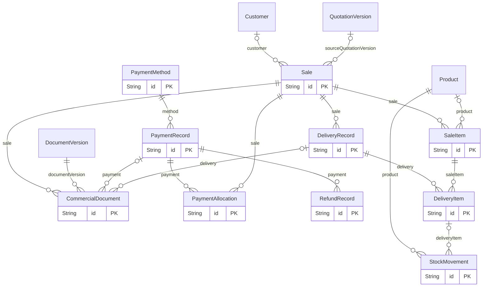

# Phase A.1 sales extension

Review only. Extends the [Phase A diagram](phase-a-schema-erd.md), not the active database. The [combined proposal](../prisma/proposals/phase-a1.prisma) and [incremental SQL](../prisma/proposals/phase-a1-extension.sql) are generated offline. Commercial documents reuse existing version, approval, immutable snapshot, private file and portal grant records.

